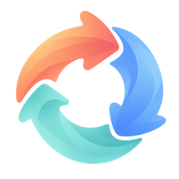
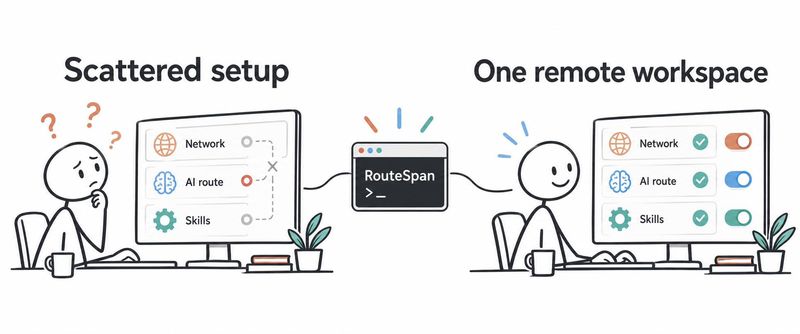
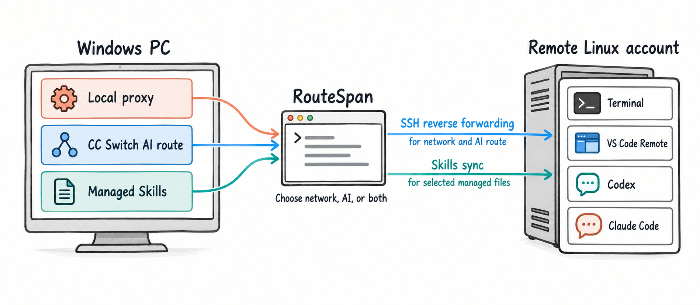
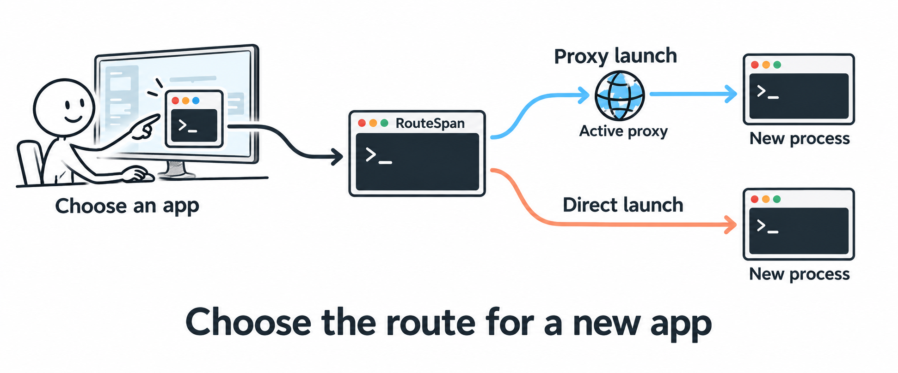
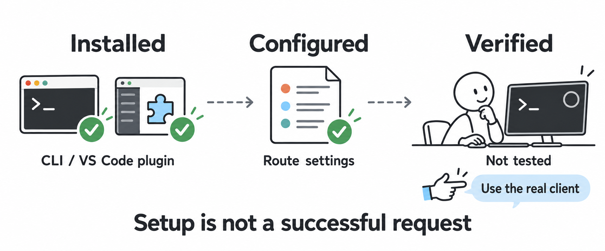

<p align="center">
  
</p>

<h1 align="center">RouteSpan</h1>

<p align="center"><strong>Extend local capabilities to remote environments.</strong></p>
<p align="center">Local Environment · Remote Bridge · CC Switch AI Route Extension</p>
<p align="center">English · <a href="README.zh-CN.md">简体中文</a></p>

<p align="center">
  <a href="docs/GETTING_STARTED.md"></a>
  <a href="LICENSE"></a>
</p>

## Release status

RouteSpan is the v0.2 display brand. The maintainer-designated previous stable
baseline is **ProxyEnv v0.1.4** (legacy brand), still **Draft** on GitHub as of
2026-10-12. The latest public release is v0.1.3; downloads are listed in
[public releases](https://github.com/GKNEETIEMAY/ProxyEnv/releases).

**RouteSpan v0.2.0 is in development on `v0.2.0dev`, not yet released.** Previews
are for manual testing, not stable updates. This README describes development;
earlier public packages do not include Remote Bridge.

## What is RouteSpan?

RouteSpan helps you understand your Windows proxy environment and extend selected
local capabilities to a remote Linux development account over SSH.

**Platforms:** Windows 10/11 x64 locally, with WebView2; a non-root Linux account
remotely. Linux/macOS desktop editions are not currently supported.

Select one active proxy, distinguish System Proxy/TUN/environment variables,
and launch new applications with proxy or direct access. The remote workspace
reuses the selection, extends CC Switch AI routes and prepares tools/Skills.

RouteSpan is not a proxy core, VPN, subscription manager or AI provider service.
You still run your own local proxy client and, for AI routing, CC Switch.

## Why RouteSpan?

<p align="center"><a href="docs/assets/routespan-workflow.png"></a></p>

Concept illustration: checkmarks show the intended setup, not verified network
access or successful model requests.

Old proxy variables, working SSH without internet, and installed AI extensions
using a different route are distinct problems. One “connected” indicator cannot
explain them all.

RouteSpan keeps the layers visible. Select the local capability once, choose an
SSH target, and enable only what that session needs. Installation, configuration
and real request verification remain distinct. You can use remote network access
without AI routing, AI routing without general network bridging, or both together.

## How it works

<p align="center"><a href="docs/assets/routespan-architecture.png"></a></p>

Network and AI use SSH reverse forwarding; selected managed Skills use file
synchronization. These illustrations explain concepts, not measured availability
or screenshots; click an illustration to enlarge. Arrows show capability flow, not packet
or SSH-establishment direction. The flow is session-scoped, not a VPN or a change
to server networking or CC Switch provider routing.

## Core capabilities

### Local Environment

- Discover supported local proxy clients and select one active endpoint.
- See System Proxy, TUN observations and proxy environment state separately.
- Apply, clear or restore selected current-user proxy environment variables.
- Diagnose a selected application and launch a new process with proxy or direct access.

Changing environment variables affects newly launched processes. Running terminals
and applications may need to be reopened; RouteSpan does not inject new settings
into them or toggle Windows System Proxy or TUN for you.

<p align="center"><a href="docs/assets/routespan-app-launch.png"></a></p>

Choose a launch environment for a **new process**. Running applications stay
unchanged; launching is not proof that the application can reach its destination.

### Remote Bridge

- Select an imported or manually saved SSH connection and authenticate with OpenSSH.
- Reuse local network access and independently extend the CC Switch AI route.
- Discover remote CLI and VS Code plugin installations, then prepare compatible tools.
- Open a remote terminal, VS Code or MobaXterm and project selected managed Skills.

**Overview** holds everyday actions; **Advanced** holds environment facts,
diagnostics and recovery. Optional preparation does not delay core Connected.

### CC Switch AI Route Extension

**CC Switch owns the route. RouteSpan supplies the span.** RouteSpan does not
replace CC Switch. It extends CC Switch-managed local AI routes to remote
development environments, without managing providers, subscriptions or OAuth.

Enable the appropriate local route in **CC Switch → Settings → Routing → Local
routing → Master routing switch → Claude/Codex routing**. RouteSpan detects the
local service, but detecting its listener does not prove that every individual
tool route is enabled or that the provider accepts a real model request.

Supported Codex/Claude settings follow the local client profile while their
remote access is enabled. Provider secrets and upstream URLs stay local. A running
CLI or extension may need a restart or reload to consume updated model settings.

## Quick start

1. Install an available Windows x64 package, or build a development preview.
2. Start your local proxy client; confirm the selected endpoint in **Local Environment**.
3. For AI access, start CC Switch and enable the corresponding local route first.
4. In **Remote Bridge**, select or add an SSH connection and choose its capabilities.
5. Connect, explicitly confirm a trusted first-seen host key, and authenticate if asked.
6. Use **Overview** to review tool preparation and open the terminal or editor you need.

Local-only use needs no SSH. External terminals may need the copied setup command;
existing Remote windows may need **Developer: Reload Window** and new terminals.
Do not reinstall working tools because a different one is unavailable.

See [Getting started](docs/GETTING_STARTED.md) for prerequisites and
[Remote Bridge](docs/REMOTE_BRIDGE.md) for the current connection flow and troubleshooting.

## Supported remote development tools

| Tool or entry | Current development behavior |
| --- | --- |
| Codex CLI | Supported `0.x` versions from `0.134`; standard remote user configuration |
| Claude Code CLI | Supported `2.x`; session-header access requires `2.1.227` or newer |
| VS Code Remote plugins | Codex and Claude discovery is separate from CLI discovery; compatible plugin-only setups can be configured |
| Terminal | RouteSpan-opened terminal loads the session environment; external terminals may require the copied setup command |
| MobaXterm | Launch integration where supported; external shell environment must be loaded as instructed |
| Skills | Only selected CC Switch-managed links, with independent Codex/Claude synchronization |

Installation is user-executed. Custom roots/runtimes can block preparation without
breaking SSH. Built-in model probing supports installed Claude CLI only; validate
Codex through its actual client.

<p align="center"><a href="docs/assets/routespan-tool-readiness.png"></a></p>

Concept example: **Installed** means found, **Configured** means settings prepared,
and **Verified** requires request evidence. CLI and plugins are discovered
separately; a compatible plugin-only setup does not require installing the CLI.
Green checks illustrate prepared states, not successful model requests.

## Security and boundaries

- General Proxy intentionally has **no proxy username/password authentication**.
  Loopback listening **does not provide per-UID isolation** on shared Linux hosts;
  another account on that host may use the active network bridge.
- AI routing separately uses a backend-managed `X-ProxyEnv-Session` token. Provider
  secrets are not copied to the remote account. This does **not protect against root**.
- First host-key trust requires confirmation; changed host keys are not bypassed.
  Eligible SSH passwords are encrypted in memory only for the current bridge.
- Default session setup does not edit `.bashrc` or `.profile`, take over TUN, or
  permit forwarding to arbitrary local destinations.
- Enabling network bridging starts one automatic external egress check. Model
  verification is explicit and may consume tokens. Generating a diagnostic report
  does not initiate a new network test or automatically save/upload its contents.
- Protected configuration writes preserve backups and refuse conflicting user changes.
  A closed tunnel is not the same operation as restoring every managed tool field.

Read [Security](SECURITY.md) before using a shared host, and
[release security](docs/release-security.md) for signatures, checksums and download trust.

## Current v0.2 status

The development branch implements Local Environment, Remote Bridge, CC Switch route
extension, tool readiness, Skills and Overview/Advanced. Implementation is not acceptance.

At baseline `6ab9ef6`, Linux extension tests, RustSec and Security audit passed.
The frontend dependency audit blocked Windows CI; later steps were skipped.
Cross-machine upgrade, native icons/DPI, signed updates and live remote acceptance
remain release gates. Evidence is in
[v0.2 release QA](docs/RELEASE_QA_V0.2.md) and plans in [Roadmap](docs/ROADMAP.md).

## Documentation

- [Documentation map](docs/README.md)
- [Getting started](docs/GETTING_STARTED.md)
- [Remote Bridge user guide](docs/REMOTE_BRIDGE.md)
- [Architecture](docs/ARCHITECTURE.md)
- [Internal contracts](docs/INTERNAL_CONTRACTS.md)
- [Security](SECURITY.md) and [release security](docs/release-security.md)
- [Roadmap](docs/ROADMAP.md) and [release QA](docs/RELEASE_QA_V0.2.md)

Use current guides, not historical design records, for setup instructions.

## Development

The desktop stack is Tauri 2, Vue 3, TypeScript and Rust. Use the Node.js/pnpm
versions declared in `package.json`, Rust stable MSVC and the Windows build tools.

```powershell
pnpm install --frozen-lockfile
pnpm build
pnpm test:docs
pnpm tauri dev
```

[Contributing](CONTRIBUTING.md) lists the complete regression commands. The
repository and several internal compatibility identifiers retain the ProxyEnv
name to preserve existing updates and user data; this is not a second product.
Do not mechanically rename the package, storage directories or updater identity.

## License

[MIT](LICENSE).
