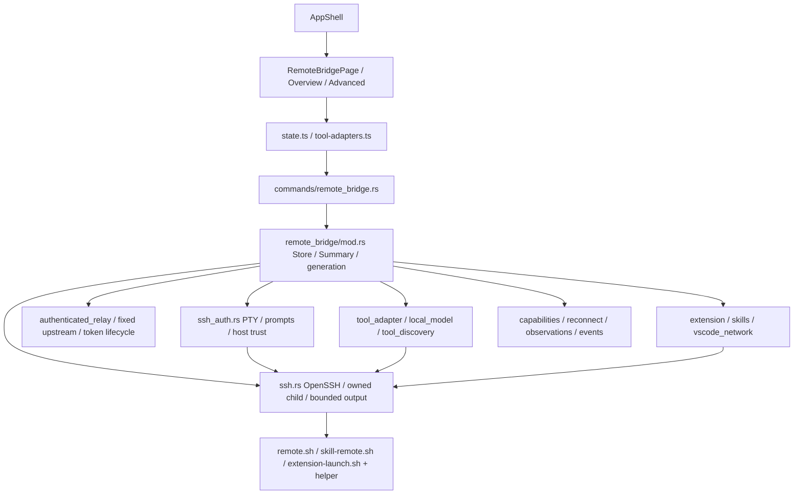

# RouteSpan v0.3.0dev — M0 研发基线报告

检查日期：2026-11-18（Asia/Shanghai）。执行依据为维护者提供的
`RouteSpan_v0.3.0dev_Codex_Execution_Plan.md`，按 M0 → M6 顺序推进。
本报告是开发基线，不是 Windows 远端功能或发行验收。

## 仓库、分支与授权

| 项目 | 实际结果 | 状态 |
| --- | --- | --- |
| 初始工作树 | 干净，无需暂存或覆盖用户修改 | PASS |
| 初始分支 | `v0.2.2dev`，追踪 `origin/v0.2.2dev` | PASS |
| 本地 HEAD / fetch 后 origin/main | `359f7812cad4f50103ae87e046fcf976df1aaccd`，与计划一致 | PASS |
| 新分支冲突检查 | 本地、远端均未发现同名分支 | PASS |
| 新分支 | 从 `origin/main` 创建本地 `v0.3.0dev`，已取消临时 main 上游追踪 | PASS |
| 推送 / 合并 / Tag / Release | 本次未执行；推送前必须呈交摘要 | PENDING |
| 生产版本 | package、Cargo、Cargo.lock、Tauri 和现有前端常量保留 `0.2.2` | PASS |
| 功能变更 | M0 仅新增本报告；SSH、更新器、配置、依赖锁和业务行为未修改 | PASS |

保留 `proxyenv`、`proxyenv_lib`、`proxyenv.exe`、Tauri identifier、既有数据目录、
`~/.proxyenv`、浏览器存储键、`X-ProxyEnv-Session`、`proxyenv_bridge`、固定更新来源、
公钥和 release-note 标记。M0 没有访问用户凭据、连接用户服务器或修改代理环境。

## 检查环境与证据

- Node `v24.14.0`，符合 package engines；pnpm `10.15.1`，保持项目锁定版本。
- Rust/Cargo `1.97.1`，Windows MSVC 本地编译；系统 OpenSSH `9.5p2`。
- Windows 系统查询返回 `Windows 10 Home China` / `2009` / build `26300`；这些字段并存，
  不据此推断已覆盖 Windows 10/11 两种实际设备。
- 最初沙箱禁止访问本机代理端口、CIM；冻结安装与完整检查随后以正常权限运行。
  环境拒绝不计为产品失败，也不计为测试通过。
- 本次原始输出保留在本地忽略目录 `artifacts/v0.3.0/M0/`，不提交私有日志。
  本报告只记录工具版本、计数和安全状态，不记录目标、用户名、配置值或命令载荷。

已阅读双语 Roadmap、中文 Architecture / Internal Contracts / Release QA / Security /
Contributing，以及 package scripts、CI / Release workflow 和下列模块。
旧文档中本机应用助手和更新说明存在部分历史措辞；M0 不顺带修改产品文档或推断新增能力。

## 模块依赖与平台耦合

### 前后端接口清单

IPC 入口集中于 `src-tauri/src/commands/remote_bridge.rs`，前端调用集中于
`src/features/remote-bridge/state.ts`，类型化工具策略为两端各自的 `tool_adapter(s)`。
本次不新增 IPC 或 UI 目标系统选择。

| 接口组 | 当前入口与契约 |
| --- | --- |
| 目标 | targets、pick_identity_file、add/update/remove_connection；导入来源和不透明 target ID |
| 预检 / 连接 | check、allocate_ports、detect_cc、preview、connect、disconnect、summary |
| 交互认证 | ssh_auth_begin/state/submit/confirm_host/finish/cancel；提示 ID、指纹、会话凭据边界 |
| 通道 / 恢复 | set_capability、retry_reconnect、clear_session_credential；修订号与 generation |
| 网络 / 观察 | check_network、test、discover_tools、run_diagnostics、diagnostics_snapshot、events |
| 工具事务 | config_preview/apply/restore_preview/restore、tool_verify；短期后端计划与确认 |
| 本机路由映射 | model_settings、save_model_settings；不复制供应商真实凭据 |
| 扩展 | extension_inspect/preview/apply；受限版本与远端 Machine 配置事务 |
| Skills | skills、enable_skill、disable_skill；归属/hash/普通文件和受限上传 |
| 会话入口 | launch_proxy_terminal、launch_manual_terminal、session_environment_command |
| 外部工具入口 | open_vscode、open_vscode_settings、reveal/open_target_config、launch_mobaxterm |
| 日志 | log_status、clear_logs、open_log_directory；有界类型化事件和允许字段报告 |

### 必须隔离的平台操作

| 代码 | 现有平台假定 | M1 处理方向 |
| --- | --- | --- |
| `ssh.rs::remote_payload/remote_execute` | allowlist JSON → shell 变量 → `sh -s`；remote.sh 分段执行 | Linux payload 所有权迁入平台模块；SSH 继续只管传输 |
| `ssh_auth.rs` 两个远端命令构造器 | `sh -c`、uname/id/ss、Linux 工具列表、Loopback 轮询 | 原字节命令转交 Linux adapter；不改 PTY 状态机 |
| `ssh.rs::managed_terminal_remote_command` | env.sh、POSIX 登录 shell | 作为 Linux 会话命令归属，保留原行为 |
| `remote.sh` | Linux-only / 非 root / ss / stat / flock / Python JSON / curl | 保持脚本原字节与安全检查；不改成跨平台脚本 |
| `tool_adapter.rs` | 工具政策及 `~/.codex`、`~/.claude` 配置路径 | 工具政策继续共用；路径归平台，不复制整套工具策略 |
| `extension.rs` / `vscode_network.rs` | Linux VS Code Server / Machine JSONC / 所有者日志 | Linux 专属能力；Windows 未支持时拒绝，不能套用 POSIX 路径 |
| `skills.rs` / `skill-remote.sh` | Linux 上传、权限、归属和原子激活 | 保留 Linux 分支；Windows Skills 不在本版范围 |
| `mod.rs` / `capabilities.rs` | 已连状态、端口候选、session-env 和后置准备 | 编排不重写；后续通过后端探测结果选择 adapter |
| `authenticated_relay.rs` / `codex_relay.rs` | 固定本机上游和会话撤销 | 平台无关，M1 不改协议或鉴权 |

`ssh.rs::output` 已有进程超时和 64 KiB 有界输出，错误归类和 owned-child 清理可复用。
工具验证有独立超时；read-only 探测在配置脚本前返回。发现到的 SSH 别名不代表远端 OS。
禁止 UI 选择直接授权 Windows 写入，也不能让未知 OS 执行 Linux 配置脚本。

## 基线检查矩阵

PENDING 不视为 PASS；完整检查失败后未到达的命令由单独执行结果补充，不改写完整检查的退出码。

| 检查 | 证据文件 | 结果 |
| --- | --- | --- |
| `pnpm install --frozen-lockfile` | install.log | PASS，退出 0，锁文件未变 |
| `pnpm check` | check.log | BLOCKED，退出 1；远端组发生 Git Bash 子进程超时 |
| Rust fmt | fmt.log | PASS，退出 0 |
| Rust `--lib --locked` | rust-lib.log | PASS，309 通过 / 0 失败 / 3 忽略 |
| Rust all-target Clippy `-D warnings --locked` | clippy.log | PASS，退出 0 |
| 单独生成助手/扩展事务 `pnpm test:extensions` | extensions.log | PASS（执行范围），41 通过 / 0 失败 / 4 跳过；跳过项目不算已验证 |
| `pnpm audit --audit-level high` | pnpm-audit.log | BLOCKED，退出 1，2 high |
| 固定 `cargo-audit 0.22.2` 安装及 lockfile 审计 | audit-install.log / cargo-audit.log | BLOCKED，工具安装成功，审计退出 1，3 vulnerabilities / 16 allowed warnings |
| 当前开发分支完整 GitHub CI | 无推送 | PENDING |
| 原生 UI / DPI / 四主题四语言 | 未启动桌面验收 | PENDING |

`pnpm check` 内各 Node 测试组计数：brand 7、docs 13、release 12、updates 24、themes 18、
tray 10、report 13、local 18，均通过且无跳过；前端类型检查/构建通过（保留已有 chunk 大小提示）。
remote 共 138 项，135 通过、1 失败、2 跳过，耗时约 18 分 23 秒。
失败为 `claude: preview, apply, stale preview, repeat apply and restore`：fixture 的
`spawnSync bash` 达到现有 60 秒子进程超时，断言收到 null 而非 0；没有删断言或延长阈值。
因此完整 check 没有继续到其末尾的 extensions / Cargo，但这两项另行执行的结果见上表。
失败发生在完全未修改的稳定源码，不能据此认定是未来 adapter 改动造成；同样不能未经复核写成环境偶发 PASS。
单项复跑证据为 `remote-claude-retry.log`：1 通过 / 0 失败 / 0 跳过，约 27.9 秒，
参数与断言不变。超时没有在单独运行时复现；完整 check 依然是失败记录，
不能据单项成功推断所有并发/机器负载场景已通过。

前端审计报告 `picomatch <=4.0.7` 的 ReDoS（`GHSA-fc5q-39xc-vjpf`），路径为
`vite > picomatch` 与 `vue-tsc > @vue/language-core > picomatch`。本次文本输出为
2 high；不据重复路径断言存在两个不同 CVE。工具给出的修复版本为 `<0.0.0`，不能用作有效升级目标。
这是未修改基线的实际失败，不能降低审计等级、加忽略或随意更新锁文件以变绿。

RustSec 同时报告锁文件中的三项漏洞：

| 依赖 | 告警 | 工具建议 |
| --- | --- | --- |
| quinn-proto 0.11.18 | RUSTSEC-2026-0523，流数量限制 | >=0.11.19 |
| quinn-proto 0.11.18 | RUSTSEC-2026-0524，Retry token 导致 panic / 内存耗尽 | >=0.11.19 |
| quinn-udp 0.5.15 | RUSTSEC-2026-0538，截断数据报后的接收循环 | >=0.5.16,<0.6.0 或 >=0.6.3 |

另有 16 项工具允许的 warning（含 unmaintained / unsound / yanked），保留原始记录，
不将其等同于三项漏洞计数。注册表撤包状态检查有多次网络超时，审计完整性也需后续复核。
旧版文档说 quinn-proto 0.11.18 解决的是当时告警，不能据此忽略新告警。
`cargo tree --locked --target x86_64-pc-windows-msvc --edges normal -i <crate>`
对这两个组件均返回 `nothing to print`，证据为两个 `quinn-*-windows-tree.log`。
这只说明当前默认 Windows normal 依赖树未显示它们，不豁免全锁文件审计，也不推断其他特性/平台的可达性。

## 真实环境与测试矩阵

| 范围 | 现有证据 / 缺口 | 状态 |
| --- | --- | --- |
| Windows 本机构建与 Rust / Node 单元测试 | 本次主机输出，见基线矩阵 | PARTIAL |
| Git Bash shell fixture | 远端组 135 通过 / 1 超时失败 / 2 跳过；使用模拟 HOME/工具，不是 Linux SSH 实机 | BLOCKED |
| 原生 Linux 扩展事务 | CI 有 ubuntu job；本次未推送、未运行该 job；Windows skip 单独记录 | PENDING |
| Linux SSH Key/Agent/Password/KBI、四种能力组合 | 未提供本次可用目标和授权凭据，不擅自连接导入目标 | PENDING |
| Windows 10/11/Server SSH 目标 | 无已验证目标；cmd/PowerShell 默认 shell、PS 5.1/7 未验收 | PENDING |
| 空格/非 ASCII 目录、普通/管理员目标 | 无真实目标证据，不修改 ACL/服务 | PENDING |
| 真实 Codex / Claude 请求 | 未进行；Claude 付费请求仍需明确触发 | PENDING |
| 强杀、休眠、远端离线、恢复冲突 | 自动化与真实场景分开，后者未执行 | PENDING |
| 安装升级 / 签名 / v0.3.0 发行 | 本次无发行授权、无版本变更 | PENDING |

对应计划 T01–T03 是 Linux 回归；T04–T18 是后续平台/通道/恢复工作，T19 UI、T20 发行均未开始。
自动化不得代替真实网络、认证、配置归属或模型请求证据。

## M1 最小设计及退出条件

1. 新增私有 `target_os.rs` 和 `platform/linux.rs`；先用枚举分派，不建立插件注册中心。
   `TargetOs` 仅表示后端已确认平台，不给当前 `RemoteTarget` 的导入兼容性重新解释含义。
2. Linux adapter 接收受限操作/参数，返回命令、stdin 载荷和既有错误分类。
   M1 先移动命令构造和脚本归属，保留已有调用包装，保持协议、参数、载荷、超时一致。
3. 用迁移前固定输入/输出快照校验所有现有 operation 的载荷与交互命令逐字一致；
   包括非法端口、hash、token、session ID 和未知 operation 拒绝测试。
   现有测试中读取 `ssh.rs` 的源码断言须随职责迁移指向正确模块，不能删安全断言。
4. Windows adapter 仅提供受控只读探针桩；没有动态用户脚本参数。
   feature gate 默认关闭，无新 IPC，不启动 Windows 路由或写入配置。
   正式 shell/PowerShell 分层发现属于 M2，须验证默认 cmd/PowerShell 行为后接入。
5. 工具配置、VS Code 与 Skills 保留现有 Linux 路径；Windows 未实现操作显式不支持。
   不为满足接口预先伪造 Windows 配置路径、ACL 成功或恢复状态。

数据流：受信 SSH 身份 → 有界只读平台证据（M2）→ backend target context → adapter →
现有 SSH 传输 → 类型化结果 → 原有 Store/generation → 允许字段摘要。前端不执行或拼接命令。

M1 修改预计限于 remote_bridge 的模块注册、Linux payload / command 归属、少量委派调用和对应测试。
`remote.sh`、更新器、relay 鉴权、包版本和用户配置不因抽象而变化。
回滚为撤回对应开发提交；M0 文档回滚不涉及用户数据。真实 Linux 零回归仍须实机证据。

## 风险与阶段结论

- P0 / BLOCKED：当前高危前端审计及 RustSec 漏洞审计失败；M0 尚不能标记全通过。
- P1 / PARTIAL：完整 check 的 Claude 事务超时，单项复跑通过；原因未定位，仍需完成一次完整绿色基线。
- P1 / PENDING：开发分支 CI 未执行；RustSec 撤包查询超时需复核。
- P1 / PENDING：缺少真实 Linux/Windows SSH 验收目标；无法声称真实 Linux 行为保持或 Windows 支持。
- P1：新开发分支不在现有 CI push allowlist。后续须仅添加 `v0.3.0dev`，保留所有 job/审计，
  呈交变更摘要后再推送；本次没有授权自动推送来取得 CI。
- P2：Node 本地版本符合 engines，但与 CI 固定的 Node 20.19.0 不同；基线结果需注明环境。

**阶段门槛：先完成并如实记录 M0。安全审计和必要回归缺口关闭前，不进入 M1 功能/重构提交。**
下一步先确定高危依赖的可验证修复路径，再恢复 M0 审计与 CI；不得用旧版发行 CI 或模拟 SSH
替代本次证据。没有稳定 Tag、Draft、Release、main 修改或生产版本升级的授权。

本次收尾只提交 M0 审计文档。后续最小处理顺序为：核对前端告警及可修复版本、
分析 Rust 两个 QUIC 组件的锁文件来源并评估精确补丁、保持原审计策略重新检查，
再排查/复验完整回归超时。依赖修复属于独立基线整改，不能混入 M1 平台重构。
CI 分支监听变更和推送需先呈交摘要；真实目标验收缺口继续按 PENDING 跟踪。
