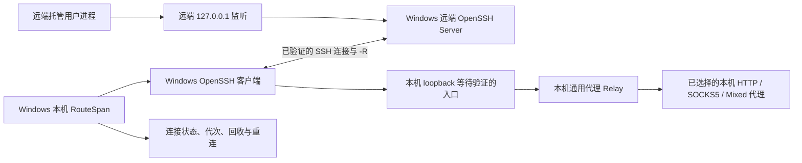

# RouteSpan v0.3.0dev — M3 Windows 网络桥接技术设计

评审稿。设计基线为 `1f877bc38b96f779ad8cd4129826136af880538c`。目标版本为 `v0.3.0`，生产版本为 `0.2.2`。
M3 为 Windows 本机到 Windows 远端增加通用 HTTP、SOCKS5 和 Mixed TCP 代理桥接。Linux 继续走现有适配器与连接入口。
本轮交付设计，所有以下标为拟议的接口与文件均待实现。
[M1.1 验收](V0.3.0_M1_1_SKILLS_TARGET_REVIEW.md) · [M2 验收](V0.3.0_M2_WINDOWS_TARGET_DETECTION_REVIEW.md)

## 1. 当前源码与拟议架构

| 当前入口 | 基线行为 | M3 拟议处理 |
| --- | --- | --- |
| [本机代理模型](../../src-tauri/src/features/proxy/models.rs)、[本机代理选择](../../src-tauri/src/features/proxy/active.rs) | `ProxyEndpoint` 提供主机、端口和协议，`active::snapshot()` 提供可用性与修订号。 | 复用快照。连接只接受已验证的本机 loopback 代理，冻结端点与修订号。 |
| [SSH](../../src-tauri/src/features/remote_bridge/ssh.rs)、[SSH 交互认证](../../src-tauri/src/features/remote_bridge/ssh_auth.rs) | `BoundTarget` 保存 SSH 生效配置指纹并固定 HostName、User、Port。已有密钥、Agent 和交互密码路径，`OwnedChild` 管理 Windows 进程。现有 `ssh::tunnel` 组装 `-N/-R`。 | 复用目标与认证、超时、进程持有约束。增加仅用于 Windows 的转发计划，隔离 Linux 的命令构造。 |
| [目标探测](../../src-tauri/src/features/remote_bridge/target_os/windows.rs)、[平台写入门禁](../../src-tauri/src/features/remote_bridge/target_os.rs) | M2 `probe_windows_target` 给出 cmd/PowerShell 命令语法证据。既有 `require_linux()` 拒绝 Windows 和 Unknown。 | 复用同类回执，要求当次目标绑定下重新确认 Windows、权限范围与转发策略。Linux 门禁保持原样。 |
| [桥接入口与状态](../../src-tauri/src/features/remote_bridge/mod.rs)、[重连](../../src-tauri/src/features/remote_bridge/reconnect.rs) | `connect`、`allocate_ports`、`check_remote_network`、`restore_transport` 的远端检查使用 Linux 载荷。`Request` 同时携带通用代理和 CC 字段。`Store` 有连接代次及目标指纹。 | 复用代次、生命周期和状态展示机制。Windows 使用通用代理专用请求与适配器，不透传 CC 字段，恢复分派与 Linux 分离。 |
| [通用代理 Relay](../../src-tauri/src/features/remote_bridge/authenticated_relay.rs) | `AuthenticatedRelay::start` 可接 `RelayMode::General`，固定上游为合法 loopback，提供 HTTP/SOCKS5 和会话停用。通用端口无附加代理口令，HTTP 过滤代理授权头。 | 复用 General 模式及其停用和释放能力。保持鉴权实现和 AI 路径原样。 |
| [Linux 适配器](../../src-tauri/src/features/remote_bridge/target_os/linux.rs)、[载荷契约](../../src-tauri/src/features/remote_bridge/target_os/linux_contract.rs) | 控制 Linux 命令、响应解析和托管终端。已有 26 个迁移基线摘要。 | 继续执行 26 项原始字节契约、主机信任及 Unknown 拒绝测试。 |

拟议的 Windows 转发计划记录目标 ID、SSH 生效配置指纹、已信任的主机密钥标识、已确认的服务端条件、命令语法、
本机代理修订号与协议、本次候选端口及连接代次。转发会话持有该计划、SSH 子进程、本机入口和通用 Relay。
这些对象由后端生成且只在内存中使用。前端发出目标选择、确认、取消、断开等意图，只接收脱敏阶段及必要的 loopback 端口。

## 2. 转发、分配与连通性

### 2.1 先确认监听策略

OpenSSH 的 `GatewayPorts yes` 可强制远端转发监听通配地址。显式 `-R 127.0.0.1:…` 和
`ExitOnForwardFailure=yes` 都无法限制服务端最终地址。首版只面向维护者或管理员已独立确认有效配置的
Windows OpenSSH 主机，允许 `GatewayPorts no` 或 `clientspecified`，且当前账号与端口的限制明确允许转发。
策略证据要关联真实主机密钥、登录账号、服务端版本、有效 `Match` 条件或等效部署策略，以及适用端口和有效期。
策略未知、失效、发生变更或为 `yes` 时，在启动带 `-R` 的 SSH 之前拒绝。普通用户能否在各支持版本上读取全部
生效设置尚无实机证据，不能把单次 M2 回执、配置文本片段或普通用户勾选作为凭据。
[OpenSSH 服务端 GatewayPorts 与转发限制](https://man.openbsd.org/sshd_config#GatewayPorts) · [Windows OpenSSH 服务端配置](https://learn.microsoft.com/en-us/windows-server/administration/openssh/openssh-server-configuration)

维护者须保证受批准的 SSH 服务端实例在凭据有效期内维持该策略。服务端重启、配置变更或策略有效期结束后，
须重新取得证据。仅凭 SSH 主机密钥未变，无法发现服务端配置已换。未解决这一部署约束前，Windows 转发只用于
可验证策略的授权测试环境。

服务端只读监听核对是第二道控制。应用控制转发请求和数据通道，服务端仍控制实际监听。首版支持范围限于可信、
受管理且远端 OS 账号之间无需隔离此 loopback 端口的主机。该端口可能被同机其他进程使用，不能当作按用户隔离。
如果目标不能满足该前提，Windows 网络桥接保持禁用。端口范围、策略证据和密钥绑定的交付方式需维护者评审。

### 2.2 建立与验证

1. **准备。** 进入连接前锁定目标和本机代理修订，核对本机 loopback 正在监听并匹配协议。使用已绑定 SSH 目标复核
   Windows 与默认 shell，确认用户选中的目标、账户和通用代理范围。密钥或认证变更后不能复用旧授权。
2. **选端口。** 用固定 Windows 只读模板在远端查询候选端口的 IPv4/IPv6 TCP 监听，仅返回候选端口状态。
   优先绑定用户确认且在策略范围内的端口，自动端口从该范围取少量候选，并排除冲突和当前会话禁止复用的端口。
   预检只是提示，最终以 sshd 成功持有监听为准。端口 0 的分配结果在不同 Windows OpenSSH 版本和非复用模式下
   尚无稳定的结构化证据，首版采用显式非特权端口。
   [.NET 监听端点 API](https://learn.microsoft.com/en-us/dotnet/api/system.net.networkinformation.ipglobalproperties.getactivetcplisteners?view=net-10.0)
3. **启动。** Windows 单独构造一条 `-R 127.0.0.1:<远端端口>:127.0.0.1:<本机入口端口>`。转发进程前台运行，
   采用 `-N -T`、`ExitOnForwardFailure=yes`、有限连接时限和 keepalive，交由 `OwnedChild` 管理。
   本机入口只处于验证模式，不向现有代理传输数据。仅已通过离线验证的直接目标可构造 Windows SSH 启动参数，
   由后端冻结完整受支持的配置，防止启动时默默带入 `LocalForward`、`RemoteForward`、`DynamicForward`
   或其他转发。M3.1 须实测或证明原主机信任要求能完整保留，例如使用隔离、只读且受保护的本机 SSH 配置快照。
   任何无法复现的路由或主机信任配置均拒绝，不能直接用忽略配置的启动方式降低校验要求。
   `ClearAllForwardings=yes` 用于无转发探针，会清掉显式 `-R`，不可直接搬到转发进程。
   [OpenSSH -R](https://man.openbsd.org/ssh#R) · [OpenSSH 客户端转发选项](https://man.openbsd.org/ssh_config#ExitOnForwardFailure)
4. **验证监听和归属。** 只读执行检查地址，要求见到 `127.0.0.1`，且该端口所有监听地址均为 loopback。
   任何通配或非 loopback 地址、无法完整查询的结果都立即关闭 SSH 进程和本机入口。再由同一绑定的远端检查进程
   经远端端口完成本次专用一次性随机回执。本机入口只在当次检查窗口接收匹配回执，不连接上游，验证后立即失效。
   只有本机确实收到回执、SSH 仍存活且绑定和代次未变时才开启通用 Relay。仅凭占用端口或 SSH 子进程存活不足以判定成功。
5. **验证代理。** 远端固定检查程序显式指定远端 loopback 代理地址，使用固定、允许的 HTTPS 健康目标和正常 TLS 校验。
   HTTP 走 HTTP CONNECT，SOCKS5 使用远端代理解析域名，Mixed 分别检查两种链路。独立的计时和有限回执区分
   监听未建立、通道失败、代理认证不兼容、代理协议失败和出口不可达。健康检查不继承用户绕过配置，不改系统代理，
   失败时不回退到直连，也不把单次测试外推为任意应用可联网。测试夹具使用合成代理及受控目标。
6. **冲突与收尾。** 已选固定端口冲突时展示错误，由用户选择换端口。自动端口仅在有明确占用证据时在原许可范围内有限重试，
   不凭模糊的转发失败文案循环。策略拒绝、异常监听、主机密钥或配置改变时停在失败态。先关闭本机入口并停用 Relay，
   再终止应用拥有的 SSH 子进程并等待回收。由 sshd 随 SSH 通道结束释放转发监听。必要时用同一绑定只读复核端口释放，
   无法确认时记录待确认，禁止结束其他进程或删除远端配置。

## 3. Windows 进程级代理环境

- PowerShell 5.1 与 7 使用同一固定语法和明确编码。cmd 默认 shell 用通过 M2 验证的固定引导方式调用 Windows PowerShell。
  M3 不假设 M2 的 `powerShell` 已区分版本，也不依赖本地 PowerShell 的版本或远端 shell 的语言。固定系统二进制不可用、
  命令被包装或回执被污染时停止；非默认系统目录的支持依赖 M2 / M3 实机结果。
- 用已认证账号的 Windows 用户配置文件路径作为托管进程工作目录，在远端使用 Windows API 获取和验证。使用 API 参数传递
  路径，覆盖空格、非 ASCII 与大小写差异，拒绝无法确认的网络路径和设备路径。不从登录名构造 `C:\Users\...`，
  不把完整用户目录回传。环境仅存在于前台托管进程，无须创建辅助文件、读取用户工具配置或提升权限。
- 启动环境为子进程专用副本。仅清理该副本里冲突的代理变量，再由受控进程启动用户选定的受支持 shell，子进程继承环境。
  Windows 环境变量名按不区分大小写处理。使用按协议定义的键，去重保留该用户进程原有的 `NO_PROXY` 条目，
  对该副本确保回环地址绕过。连通性检查使用显式代理选项，覆盖不读取环境变量的客户端差异。
  [Windows 进程环境说明](https://learn.microsoft.com/en-us/windows/win32/procthread/environment-variables) · [PowerShell 环境作用域](https://learn.microsoft.com/en-us/powershell/module/microsoft.powershell.core/about/about_environment_variables?view=powershell-7.6) · [curl 代理变量和协议](https://curl.se/docs/manpage.html#ENVIRONMENT)
- 托管进程启动走独立的显式用户动作。打开托管 shell 的 SSH 会话在变更子进程环境前再次确认目标指纹、SSH 主机密钥、
  当次 Windows 回执、端口及代次，并确认现有隧道能到达本机入口。保留固定启动模板与参数白名单。
  启动回执要来自真实的托管子进程或其固定前置验证步骤，回执以前不宣称环境就绪。独立登录、已有应用与服务没有继承该环境。
- 退出或取消时回收本应用持有的 SSH/终端进程。应用不启动脱离会话的远端工作进程。异常掉线可能有仍存活的用户子进程，
  其旧端口立即视为失效，提示用户退出或重新打开托管终端。Windows OpenSSH 在断线和关闭终端时的实际进程生命周期待实机验证。

| 代理协议 | 子进程环境 |
| --- | --- |
| HTTP | `HTTP_PROXY`、`HTTPS_PROXY` 指向 `http://127.0.0.1:<端口>`。 |
| SOCKS5 | `ALL_PROXY` 指向 `socks5h://127.0.0.1:<端口>`。 |
| Mixed | 同一端口同时提供 HTTP 两项与 SOCKS5 的 `ALL_PROXY`。两种路径均可验证。 |

## 4. 安全与确认边界

| 风险 | 实施要求 |
| --- | --- |
| 误把探测当授权 | M2 的 `confirmed` 仅说明当前 SSH 命令可运行。用户确认和服务端策略证据必须单独成立。打开 `-R` 与启动带环境的 Windows 进程前重新验证绑定、密钥、账号、代次、Windows 证据、本机代理修订及所选端口。Windows 和 Unknown 仍不可进入旧 Linux 写入入口。 |
| 配置竞态与信任切换 | 复用已有严格主机密钥检查和认证流程。新的指纹或目标绑定使旧会话确认失效。使用批准且能在实际 SSH 握手中兑现的主机密钥策略，不能依靠未经认证的扫描结果。多版本上无法完整冻结和保留信任约束的目标拒绝启用。 |
| 跳板和外部命令 | 首版沿用 M2 的 `ProxyJump`、`ProxyCommand`、`KnownHostsCommand` 和 `CheckHostIP` 限制。保留 Linux 普通 SSH 行为。自定义执行钩子如不能审查和冻结，其 Windows 连接计划不可用。 |
| 本机代理及工具凭据泄漏 | 不导出本机代理认证信息，不传 SSH 私钥或 Agent 套接字。不复制 CC Switch 数据库、API Key、模型路由认证头或配置。登录密码沿用 SSH 认证流程；Windows 通用代理仅接不要求额外凭据的本机上游，现有通用 Relay 过滤代理认证头。 |
| 持久改写与端口暴露 | 不写注册表、用户持久环境、WinHTTP、WinINET、系统代理、防火墙、权限、服务或 `sshd_config`，不使用 `setx`。客户端和服务端监听限 loopback。界面和事件日志只保留阶段、错误类别及必要的端口信息。 |

## 5. 会话状态、失败与恢复

| 状态 | 进入条件与可见信息 | 下一个状态或失败处理 |
| --- | --- | --- |
| `Idle` | 无会话，选择目标与本机代理。 | 开始后到 `Detecting`。 |
| `Detecting` | 读取本机代理与 SSH 配置，对已信任目标执行只读 Windows 检查。 | 缺认证时到 `Authenticating`，诊断及确认完成后到 `TunnelStarting`。Unknown 或策略不明时到 `Failed`，无转发。 |
| `Authenticating` | 通过既有 SSH 流程处理首次信任、密钥、Agent 或密码。按提示显示可取消状态。 | 成功回到 `Detecting` 重新确认，主机密钥变化或认证失败到 `Failed`。 |
| `TunnelStarting` | 打开待验证的 SSH 转发。 | 监听及通道证据齐全后到 `TunnelReady`。冲突尝试下一已授权候选，终止错误回收资源后到 `Failed`。 |
| `TunnelReady` | 显示已验证的 loopback 地址。可显式打开托管终端。 | 子进程继承验证后到 `EnvironmentPrepared`。用户可在此状态维持仅隧道；终端启动失败撤销该子进程并显示原因。 |
| `EnvironmentPrepared` | 指定托管进程已收到代理环境。 | 协议出口检查通过到 `Verified`，检查失败保持当前状态并显示失败类别。安全前提丢失则撤销会话。 |
| `Verified` | 通道、环境和指定协议的出口均有当前代次证据。首轮出口检查可提前至隧道就绪时，只有两类证据齐全才显示此状态。 | 复检失败或证据过期时降到 `EnvironmentPrepared` 并清除验证标志。传输退出到 `Disconnected`。 |
| `Disconnected` | 本机转发入口已关闭，清除地址可用标志和旧诊断。 | 用户主动断开后回 `Idle`。同一绑定的暂时断连进入 `Recovering`。 |
| `Failed` | 显示具体阶段与可行动错误，未完成资源已经回收。 | 由用户修正并重试，或回 `Idle`。 |
| `Recovering` | 有上限的退避，复核原绑定、代理修订、主机密钥和当前服务端条件。 | 回 `Detecting` 后重新建立并验证。配置或信任变化需要用户重新确认，停止自动恢复。 |

取消适用于探测、等待认证、转发建立、环境启动、验证和恢复。先使代次失效并封闭本机转发，再回收 SSH 与关联进程。
晚到的回执不可恢复可用状态。自动恢复禁止改选目标或本机代理，只有原条件不变且端口确认已释放时可优先复用；
只有此前允许自动端口时可在原范围重新分配。端口或代次改变后清除旧环境就绪标志，用户显式重开托管进程。
Windows 和现有 Linux 会话共用单一活动会话约束，切换先完成旧会话收尾，两个并发请求最多提交一个代次。

## 6. 测试矩阵

| 层级 | 场景 | 验收要点 |
| --- | --- | --- |
| 单元 | 固定 SSH 参数、端口排序、IPv4/IPv6 监听、策略证据绑定、随机回执、短输出和恶意超限、代理环境矩阵、Windows 大小写 | 无空地址或通配绑定。未知策略、Unknown 平台、错误代次或指纹、未确认目标均不会启动转发或环境进程。 |
| 单元 | 状态转移、重试、取消、主机密钥与配置切换、端口复用规则 | 旧回执无效、已确认的非同目标操作被拒绝。保持 Linux 26 项字节契约及现有断言。 |
| 模拟集成 | 伪 SSH 子进程、假监听、碰撞与端口被抢占，双目标 A/B，超时、EOF、网络失活、并发连接、反复开关 | 可重复触发阶段与失败，证明先停止上游数据转发再处理连接资源，清理只限当前代次对象，异常监听不会开启本机上游。 |
| 模拟集成 | HTTP、SOCKS5、Mixed 合成代理，认证不可用，回执串线，错误端口已有其他代理，TLS/出口失败 | 能区分隧道就绪与出口验证，生成正确进程环境，既有 Relay 鉴权和数据过滤断言通过。 |
| 模拟集成 | `GatewayPorts=yes` 或未知、`ProxyJump`、`ProxyCommand`，Windows/Unknown 落到 Linux 分派的尝试 | 启动前拒绝并无公网转发；使用模拟记录验证该路径，不在真实公网测试通配监听。 |
| Windows 实机（PENDING） | Windows 11、Windows Server；cmd、Windows PowerShell 5.1、PowerShell 7 默认 shell；直接连接，密钥、本机 Agent、密码 | 验证各环境真实命令转义、主机密钥绑定、已批准的服务端 loopback 策略和实际监听。记录账号类型、SSH 版本和有效策略证据。未提供的组合保持 PENDING。 |
| Windows 实机（PENDING） | HTTP/SOCKS5/Mixed、端口冲突、占用后改选、主动断开、断网和恢复、取消、并发、主机密钥变化、目标配置切换 | 核对真实监听、上游、托管子进程继承及退出、端口释放和重新分配。用受控旁路主机交叉验证无非 loopback 监听。对比用户和系统配置摘要，保持权限不变。 |
| Linux 回归 | 所有原脚本契约和既有桥接/扩展自动化；获准 Linux 主机上的 SSH/SCP 与通用代理链路 | 校验 26 项原始载荷摘要、现有认证、配置和恢复路径。Linux 扩展文件系统 CI 是自动化证据，真实 SSH/SCP 仍单独验收。 |

所有设备测试使用明确授权的专用测试主机、普通测试账号和可回收环境。记录构建 SHA、服务端版本、配置与主机密钥
参考摘要、各状态转移、端口前后及资源清单，避免收集原始命令输出或凭据。
[Linux SSH/SCP 验收计划](V0.3.0_M1_LINUX_SSH_SCP_ACCEPTANCE.md)

## 7. 建议的开发提交顺序

下列路径均为预期范围。实验入口在完整实机验收前不接入默认连接流程。
表中的 `target_os/`、`ssh.rs` 和 `reconnect.rs` 均位于 `src-tauri/src/features/remote_bridge/`。

| 提交 | 预期文件 | 接口与数据流 | 测试与安全检查 | 完成定义与回滚 |
| --- | --- | --- | --- | --- |
| M3.1 目标与计划 | 新建 `target_os/windows_bridge.rs`，按需调整 `target_os.rs`、`ssh.rs` 的内部接口 | 从目标绑定、确认和策略证据构造纯 Windows 计划，生成只含已许可选项的固定参数。 | 双目标、变化的密钥和指纹、Unknown、跳板、缺失策略及禁止通配。用 Windows OpenSSH 验证启动配置快照可重现信任约束。 | 确认无法构造越权计划，尚无发起转发的正常入口。单独撤销提交即可丢弃计划。 |
| M3.2 隧道与验证 | `target_os/windows_bridge.rs`、`ssh.rs`，拟增 `windows_forward.rs` 及其 Rust 夹具 | 接受已绑定计划，管理本机入口、SSH 子进程和 General Relay，返回已验证的 loopback 转发会话。 | 端口冲突、错误监听、回执串线、两协议和 Mixed、超时与关闭。Linux 26 项载荷、原 Relay 鉴权回归。 | 受控夹具证明校验前无真实上游流量，失败能回收。关闭内部入口或撤销提交，Linux 仍走原路径。 |
| M3.3 进程环境 | 拟增 `target_os/windows_environment.rs`，调整 `ssh.rs`、`windows_bridge.rs` 和对应测试 | 已验证会话与最新目标确认进入托管启动器，子进程环境及状态按代次提交。 | 三种 shell、路径和环境矩阵、用户取消、断开及失效回执。核对无持久写入或凭据输出。 | 进程确实继承正确环境，关闭后无需远端文件清理。撤销托管入口与本步提交，隧道测试仍可独立运行。 |
| M3.4 生命周期与界面 | 后端 `remote_bridge/mod.rs`、`reconnect.rs`、`commands/remote_bridge.rs`、`lib.rs`。前端 `src/features/remote-bridge/state.ts`、`components/RemoteBridgePage.vue`、`components/RemoteBridgeOverview.vue`、`src/shared/i18n/remote-bridge.ts`。验证 `scripts/test-remote-bridge.mjs`、`scripts/test-bridge-capabilities-ui.mjs`。 | 接入显式 Windows 连接、取消、状态和恢复。使用现有事件与错误风格，按 OS 分流，保持 Linux 入口行为。 | 代次与竞争、断连恢复、端口重分配、Windows 实机矩阵、Linux 回归、语言适配。 | 独立审查真实设备证据，所有受支持路径符合门禁才可开启面向用户的 Windows 连接。回滚此提交可移除界面入口和接线，无远端持久迁移。 |

## 8. M4 边界与启动建议

M3 只交付通用代理转发、进程环境与会话生命周期。Codex、Claude、CC Switch 的 AI 路由、API Key、
工具配置、VS Code 扩展配置及 Relay 鉴权属于后续独立范围。

建议在维护者确认服务端策略证明、主机密钥绑定方式及首版可信主机范围后，启动 **M3.1** 的计划接口和夹具开发。
Windows 转发启用需先验证受管理 Windows OpenSSH 上能履行 loopback-only、配置冻结和 SSH 清理约束。
Linux SSH/SCP 与 Windows OpenSSH 实机证据继续登记为 PENDING，作为相应能力验收和正式发布评审的输入。
