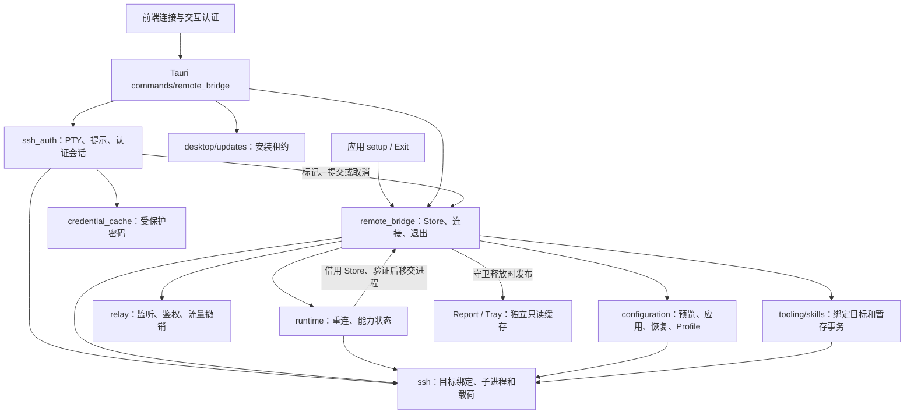
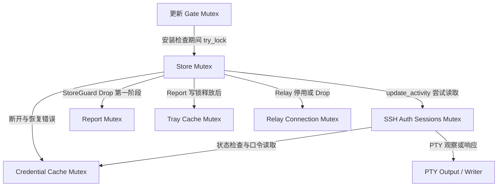
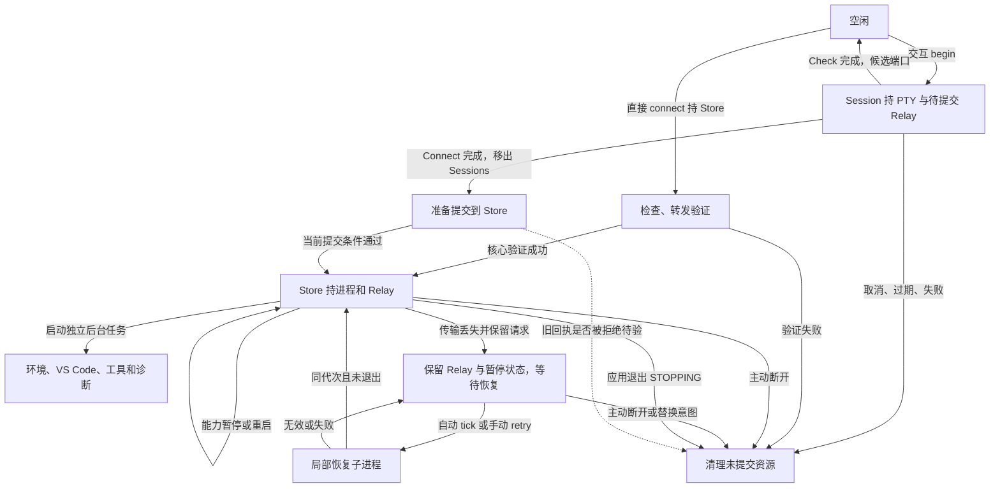

# RouteSpan v0.3.0dev R4.6a 桥接所有权与生命周期审计

开工时 `v0.3.0dev` 工作区干净。fetch 后，本地 HEAD、跟踪引用、实际远端 HEAD 和 CI `head_sha` 均为 `cbebc2ad73dd1a00bdf63d24f5737d66f3853d04`。Windows 构建与测试、Linux 扩展文件系统、前端审计、Windows 本机 UI、RustSec 和 Security Audit 六项为 `completed/success`。R4.5b 到基线只增加了文档。[基线 CI #45636447033](https://github.com/GKNEETIEMAY/ProxyEnv/actions/runs/45636447033) · [R4.5 汇总](V0.3.0_REMOTE_BRIDGE_R4_5_SUMMARY.md)

以下源码行号均指向审计基线。现阶段明确保留单一 `StateStore`、原 `StoreGuard::drop` 发布边界和现有资源所有权。真实 Windows 转发仍由 M3.2 的独立主机信任、策略、冻结文件、监听归属和撤销门禁约束。[拆分设计](V0.3.0_REMOTE_BRIDGE_R4_SPLIT_DESIGN.md) · [M3.2 安全前置](V0.3.0_M3_2_FORWARDING_SECURITY_PRECHECK.md) · [M3.2 接线准备](V0.3.0_M3_2_SECURITY_WIRING_PREPARATION_REVIEW.md)

## 模块职责与依赖

根模块集中了会话提交和资源关闭，重连与能力模块通过借用同一 Store 维护相同的连接身份。配置模块已有独立的预览、应用和恢复边界，事务仍依赖当前会话、目标和 Relay。认证 Session 表只拥有未交接的 PTY 与待提交 Relay。报告与托盘通过投影观察，前端持有页面意图和认证代次。[应用入口](../../src-tauri/src/lib.rs#L25) · [IPC 包装](../../src-tauri/src/commands/remote_bridge.rs#L93) · [前端连接](../../src/features/remote-bridge/composables/useRemoteConnectionFlow.ts#L109)

## Store 字段所有权

表中 `Store` 指 `StateStore.inner` 的唯一 `Mutex<Store>`。表内字段均从 `Store::default` 初始化。建立连接前的子进程和 Relay 可先属于调用栈或待认证会话。投影只读借用或复制 DTO，不接收运行资源。[Store 与默认值](../../src-tauri/src/features/remote_bridge/mod.rs#L339)

| 字段 | 创建、所有权转移及修改 | 借用、失效、释放和锁 | 敏感性及已有证据 |
| --- | --- | --- | --- |
| `child` | 直接连接创建 `OwnedChild`，交互认证把 `PtyProcess` 从 Session 移入 Store，恢复任务把验证过的替换进程移入 Store。[提交入口](../../src-tauri/src/features/remote_bridge/mod.rs#L2256) | Store 下由 refresh、能力入口、诊断和更新观察借用。传输丢失、断开和拿到锁的退出使其 Drop。迟到的恢复结果由任务局部析构。 | 私有进程句柄。已有进程回收和传输恢复测试。[进程测试](../../src-tauri/src/features/remote_bridge/ssh/mod.rs#L2320) |
| `additional_tunnels` | 能力新增分支在验证后把新子进程移入 Store 的向量。[追加通道](../../src-tauri/src/features/remote_bridge/runtime/capabilities.rs#L596) | Store 下 refresh 检查每个子进程。任一附加通道失效触发整组传输恢复，断开和退出清空。 | 私有句柄。覆盖附加通道丢失。[恢复测试](../../src-tauri/src/features/remote_bridge/runtime/reconnect.rs#L327) |
| `proxy_relay` | `relays_for`、新增通道创建，直接连接或交互完成后交给 Store。[Relay 创建](../../src-tauri/src/features/remote_bridge/mod.rs#L1871) | Store 下由能力、端口、环境命令和恢复借用。暂停关闭本地闸门但保留所有权，主动断开撤销并 Drop。 | 私有监听、会话 ID 与内部密钥。覆盖暂停、恢复及 Drop。[Relay 测试](../../src-tauri/src/features/remote_bridge/relay/authenticated_relay.rs#L629) |
| `ai_relay` | 同一建立路径拥有唯一的 AI Relay，General Relay 只持其 `AiRoute` 的共享会话引用。[Relay 建立](../../src-tauri/src/features/remote_bridge/relay/authenticated_relay.rs#L149) | Store 下工具、诊断和能力借用，其后台任务截取所需 token 或 ID。暂停收紧闸门，显式断开撤销。 | token 是凭据。已有错误路由拒绝、凭据剥离与撤销测试。[鉴权测试](../../src-tauri/src/features/remote_bridge/relay/authenticated_relay.rs#L1036) |
| `connection_generation` | Store 持有。新建立意图走 `reconnect::cancel` 递增，主动断开单独递增，普通传输恢复复用该值。[代次入口](../../src-tauri/src/features/remote_bridge/runtime/reconnect.rs#L222) | 各 Job 在 Store 下复制并复核。退出当前使用单独的 `STOPPING`，未统一递增或检查。 | 非密钥。发现 guard 有代次负例。[发现测试](../../src-tauri/src/features/remote_bridge/tests.rs#L159) |
| `last_request` | 直接及交互提交保存请求，能力变更更新端口和适用的代理修订。[能力更新](../../src-tauri/src/features/remote_bridge/runtime/capabilities.rs#L117) | 恢复复制请求。意图替换及断开置空，普通断线保留。依赖 Store。 | 目标 ID、端口及修订。覆盖重连保留目标及暂停通道。[恢复测试](../../src-tauri/src/features/remote_bridge/runtime/reconnect.rs#L266) |
| `target_fingerprint` | 建立时从有效 SSH 配置计算，提交时设到 Store。[直接提交](../../src-tauri/src/features/remote_bridge/mod.rs#L2398) | 恢复、配置、Skills、探测和发现借用或复制。断开后可能仍有旧值，实际资格依赖进程、代次或事务，同时核验目标。 | 稳定配置标识，非 SSH 主机公钥或认证凭据。Skills 有重绑定负例。[目标测试](../../src-tauri/src/features/remote_bridge/ssh/mod.rs#L1782) |
| `reconnect` | refresh 识别传输丢失并在有 `last_request` 时创建 Retry。tick 更新退避，resume 恢复同一任务。[恢复状态](../../src-tauri/src/features/remote_bridge/runtime/reconnect.rs#L15) | 由 Store 唯一持有。成功、显式断开及新连接意图清空，异步 Job 只保存元数据。 | 状态与错误类别。已有重连条件和认证失败暂停测试。[恢复测试](../../src-tauri/src/features/remote_bridge/runtime/reconnect.rs#L405) |
| `pending` | CLI 预览及恢复预览构造 Pending，apply/restore 在 Store 下 `take` 消费，同一实现供自动配置使用。[事务入口](../../src-tauri/src/features/remote_bridge/configuration/config_transaction.rs#L145) | 工具、托盘、能力和同步以占用状态为门禁。ID、期限、目标和文件哈希参与校验。断开、丢失、重新建立及能力变更清空。 | 含目标、指纹、文件哈希及本机 Profile 投影，非 Relay token。覆盖未确认、过期和恢复。[事务测试](../../src-tauri/src/features/remote_bridge/tests.rs#L249) |
| `extension_pending` | 插件 preview 持有单槽，apply 在 Store 下取走并检查 ID、期限、目标指纹、运行时上下文哈希。[插件事务](../../src-tauri/src/features/remote_bridge/tooling/extension.rs#L368) | 托盘、自动配置和能力读取占用状态。断开、丢失、重建、能力切换及新预览清除旧槽。 | 含上下文、环境路径与所有权线索。扩展文件系统夹具覆盖预览、应用、恢复。 |
| `profile_syncing` | monitor 在 Store 下认领布尔位，同步路径回写。丢失、断开及取得 Store 的退出重置。[监控认领](../../src-tauri/src/features/remote_bridge/mod.rs#L1094) | 工具、更新、托盘、配置及能力读取。当前是共享忙位，未与单个 Job 所有权绑定。 | 非敏感。已有轮询公平性和状态投影覆盖，旧任务清除新忙位待核验。[同步结束](../../src-tauri/src/features/remote_bridge/mod.rs#L747) |
| `local_codex_profile` | 本机解析，配置或同步以 `set_cached_profile` 按工具移动到 Store。[缓存操作](../../src-tauri/src/features/remote_bridge/mod.rs#L759) | monitor 与配置借用或复制，按 OFF、失配、丢失、断开或退出清理。 | 私有配置路径、模型、目录和哈希，需保持脱敏。已有本机模型测试。[Codex 解析](../../src-tauri/src/features/remote_bridge/configuration/local_model.rs#L288) |
| `local_claude_profile` | 本机解析并由同一工具缓存入口写入，启用 CC 时可提交当前验证后的 Profile。[暂停恢复](../../src-tauri/src/features/remote_bridge/runtime/capabilities.rs#L355) | 同 Codex 生命周期，工具状态独立。Store 下读取，预览拿到筛选后的数据。 | 私有路径、设置字节及哈希。已有允许字段与保存中损坏保护测试。[Claude 解析](../../src-tauri/src/features/remote_bridge/configuration/local_model.rs#L178) |
| `paused_proxy` | 暂停把 `summary.proxy` Endpoint 移入 Store 的暂停槽，恢复时 `take` 回 Summary。[暂停](../../src-tauri/src/features/remote_bridge/runtime/capabilities.rs#L205) | Store 下恢复用 `transport_summary` 保留原端口，断开或新意图取消清空。 | 本机地址和远端端口。覆盖断线保留已暂停通道。[恢复测试](../../src-tauri/src/features/remote_bridge/runtime/reconnect.rs#L266) |
| `paused_cc` | CC 暂停后 Endpoint 移入暂停槽，成功恢复后移回 Summary。[CC 恢复](../../src-tauri/src/features/remote_bridge/runtime/capabilities.rs#L423) | Store 与 Relay 本地闸门共同约束，可保留至同一会话恢复，主动断开或新意图取消清空。 | 地址及端口。合成能力和恢复测试覆盖。 |
| `paused_tools` | CC 暂停逐项记录已恢复的工具，恢复时借用其清单重新检查本机 Profile，成功后清空。[暂停工具](../../src-tauri/src/features/remote_bridge/runtime/capabilities.rs#L235) | Store 持有工具 ID，显式断开和新意图释放，失败保留可恢复的状态。 | 工具 ID。部分失败的回读/补偿和 OFF 覆盖在现有能力夹具。 |
| `disabled_tools` | 手动恢复把工具加入显式 OFF 清单，显式应用移除。新建意图清空。[配置恢复](../../src-tauri/src/features/remote_bridge/configuration/config_transaction.rs#L312) | Store 下自动资格和恢复路径读取，保留至同一桥接生命周期，断开时可能仍有旧值直到下一意图。 | 工具 ID。已有用户 OFF 优先测试。[工具资格](../../src-tauri/src/features/remote_bridge/tests.rs#L122) |
| `summary` | Store 持有私有运行视图，建立原子替换，之后由观察、能力、认证和配置更新。 | 读者复制经相应投影的 DTO，Report/Tray 独立缓存。断开保留目标等诊断上下文，重建替换。 | 含目标和路径等详细信息，Report 走允许字段投影。已有快照和争用测试。[报告测试](../../src-tauri/src/features/remote_bridge/tests.rs#L530) |
| `events` | Store 持有有限事件队列，连接、断开、恢复、能力和配置写入结构化事件。 | Store 下按限额复制最近记录，新连接意图和成功取得锁的退出清队列。 | 只保存结构化类别、时间和耗时。已有容量及脱敏测试。[日志事件](../../src-tauri/src/features/remote_bridge/observability/events.rs#L115) |
| `ssh_auth` | Store 持有用于已建立桥接的认证投影，直接建立、交互检查/建立、恢复和清凭据更新。 | Store 下复制到 Summary。传输丢失清认证位，已保存密码标记与独立 Cache 关联，认证会话本体仍由 Sessions 管理。 | 认证方法和布尔值，输入与受保护密码在 Session/Cache。IPC 序列化与凭据范围已有覆盖。[序列化测试](../../src-tauri/src/features/remote_bridge/tests.rs#L1034) |

其余字段均由 Store 保护。能力会话持有 `capability_vscode_managed`，发现持有 `tool_discovery_fingerprint` 和 `tool_discovery_ticket`，运行观察持有 `cc_detected`、`reachable`、`proxy_status` 和 `cc_status`。配置持有 `follow_local_codex_profile`，连接计时持有 `connect_started_at`。它们是状态或标识，能力释放、发现失效和连接重建各有独立的更新点。[发现失效](../../src-tauri/src/features/remote_bridge/tooling/tool_state.rs#L3) · [状态刷新](../../src-tauri/src/features/remote_bridge/mod.rs#L568)

## 锁顺序与发布

- `store()` 通过 OnceLock 创建唯一 StateStore。`lock` 和 `try_lock` 返回同一种守卫。Report 读取直接从缓存克隆，托盘显示也直接读缓存。Drop 持有 Store，先构建脱敏报告并短时写 Report，再发布 Tray 并用非阻塞通知队列发出通知，最后由字段析构释放 Store。两个缓存的发布有先后，读取双方的调用方之间可观察到短暂差异。panic 期间跳过发布，Store 毒化后正常访问失败或跳过，已有缓存继续显示最近完整投影。[StateStore/Drop](../../src-tauri/src/features/remote_bridge/mod.rs#L410) · [报告脱敏](../../src-tauri/src/features/remote_bridge/observability/projection.rs#L6) · [托盘缓存](../../src-tauri/src/features/remote_bridge/integrations/tray_state.rs#L70)
- 更新检查持有 Gate 并尝试读取 Store 及 Sessions。IPC 的 `BridgeOperation` 是计数凭证，释放 Gate 后执行工作。同一时刻可以有多个桥接 IPC，安装租约才拒绝新增操作。认证 `finish`、`cancel` 在访问 Store 前已释放 Sessions。托盘操作检查也先释放 Gate。上述路径未发现 Gate/Store 或 Sessions/Store 的 ABBA。凭据操作返回后才请求 Store 的路径不嵌套这两个锁。[更新 Gate](../../src-tauri/src/desktop/updates.rs#L65) · [更新活动](../../src-tauri/src/features/remote_bridge/mod.rs#L477) · [IPC 包装](../../src-tauri/src/commands/remote_bridge.rs#L93) · [凭据](../../src-tauri/src/features/remote_bridge/ssh/credential_cache.rs#L18)
- 直接连接、断开、CLI/插件事务和能力切换持有 Store 执行有界远程 I/O，部分路径持锁发生子进程 `kill/wait`、Relay `join` 和 VS Code 还原。Sessions 的状态/提交持锁读取 PTY 或写响应，过期 retain 和 shutdown 清空可能在 Sessions 持锁时析构进程。缓存读锁短，但持锁的 I/O 会延长其他桥接写操作和退出等待。[直接连接](../../src-tauri/src/features/remote_bridge/mod.rs#L2327) · [配置事务](../../src-tauri/src/features/remote_bridge/configuration/config_transaction.rs#L157) · [PTY](../../src-tauri/src/features/remote_bridge/ssh/ssh_auth.rs#L913)
- `reconnect::tick` 争用时延后至下一轮。退出的 `try_lock` 跳过资源清理后，却经 `ssh_auth::shutdown` 调用带阻塞 Store 锁的 `cancel_interactive_connect`。调用链已由源码确认，实际退出可等待 Store 所有者，R4.6b 应用无网络本机夹具检验。另需检验 Store 或 Sessions 未取得时是否有后续清理，以及仍在运行的后台任务是否响应 `STOPPING`。[退出](../../src-tauri/src/features/remote_bridge/mod.rs#L2527) · [认证退出](../../src-tauri/src/features/remote_bridge/ssh/ssh_auth.rs#L1089) · [再次获取 Store](../../src-tauri/src/features/remote_bridge/mod.rs#L2247)

## 生命周期和标识

- 直接连接从 `connect` 锁内撤销恢复状态、验证目标/端口、启动并检查传输，到一次性移交进程和 Relay 后释放 Store，才启动 post-connect。已派发的阻塞 IPC 不受前端 revision 取消。此时主动断开要排队取得 Store，目标切换只是前端意图变化，是否阻断提交取决于后端入口。代理修订变化对直接与交互的代理通道由提交前 `preview` 复核。正常恢复复用请求的修订与现有端点。[连接流程](../../src-tauri/src/features/remote_bridge/mod.rs#L2327) · [恢复验证](../../src-tauri/src/features/remote_bridge/runtime/reconnect.rs#L180) · [前端派发](../../src/features/remote-bridge/composables/useRemoteConnectionFlow.ts#L84)
- 交互 begin 先准备本地 Relay/PTY，`mark_interactive_connecting` 后再插入 Sessions。state 根据真实输出、固定目标、提示 ID 和进程状态推进。submit 与 confirm_host 在 Session 下核对相应提示类型。finish 从 Sessions 取走 Session 后写目标指纹关联的缓存，再交给交互检查或连接。cancel 或 cleanup 先取走/清除 Session，再更新桥接状态，当前 `cancel_interactive_connect` 未接收 Session ID。前端以 revision 和 session ID 约束 UI 提交，切换目标和卸载会失效前端认证。旧后端任务的 A/B/A、断开及退出窗口仍须单独验收。[认证开始](../../src-tauri/src/features/remote_bridge/ssh/ssh_auth.rs#L648) · [响应](../../src-tauri/src/features/remote_bridge/ssh/ssh_auth.rs#L940) · [完成和清理](../../src-tauri/src/features/remote_bridge/ssh/ssh_auth.rs#L992) · [前端取消](../../src/features/remote-bridge/composables/useRemoteInteractiveAuth.ts#L245) · [卸载](../../src/features/remote-bridge/components/RemoteBridgePage.vue#L871)
- 主动断开先递增 generation、清请求和恢复；保存目标和必要的 Relay ID；撤销两个 Relay 并关闭本地流量；恢复 VS Code、移除对应环境；清主进程、事务、附加隧道、暂停槽及 Profile；清凭据并由 Drop 发布。意外断线先释放附加及主进程，有可恢复请求时继续保留 Relay、暂停状态和复连请求。手动 retry 只使已有 Retry 重新调度。应用退出先置 STOPPING，再尝试清主进程、附加隧道和 Relay，随后清 Cache、Sessions 和日志，释放顺序与主动断开不同。[断开和退出](../../src-tauri/src/features/remote_bridge/mod.rs#L2438) · [恢复状态](../../src-tauri/src/features/remote_bridge/runtime/reconnect.rs#L69) · [应用退出入口](../../src-tauri/src/lib.rs#L139)
- `AuthenticatedRelay::drop` 撤销会话、关闭已追踪 socket、唤醒本地 listener 并 join。Codex Relay 子模块在现有 AI 鉴权后处理请求，Store 不另外持该处理器的第二份 Relay。OwnedChild 终止及等待子进程，再关闭 Windows Job；PtyProcess 终止及等待子进程，独立 PTY reader 由关闭的通道退出，代码无对应 JoinHandle。M3.2 的先加入 Job 的离线夹具不代表交互 PTY 的退出边界已具备同样保障。[Relay Drop](../../src-tauri/src/features/remote_bridge/relay/authenticated_relay.rs#L284) · [Codex 路径](../../src-tauri/src/features/remote_bridge/relay/codex_relay.rs#L117) · [OwnedChild](../../src-tauri/src/features/remote_bridge/ssh/mod.rs#L1321) · [PtyProcess](../../src-tauri/src/features/remote_bridge/ssh/ssh_auth.rs#L117)

| 标识 | 作废或作用域 |
| --- | --- |
| SSH Auth session ID | Sessions 槽位及 PTY 提示，finish/cancel/TTL 消费。 |
| 后端 connection generation | 新建立意图或主动断开切换，正常传输恢复复用。 |
| 前端 auth revision | 页面内 begin/cancel/切换/卸载的回写门槛。 |
| Relay session ID 与 token | ID 标识环境/VS Code 所有权，token 认证 AI，会话暂停/恢复保留，Drop 撤销。 |
| 工具发现 ticket | 同代次内可更新的发现请求序号，同时绑定目标 ID 和配置指纹。 |
| 配置事务 ID | CLI 与插件各自的单次预览令牌，应用还验证 TTL、目标和原文件证据。 |
| 活动代理 revision 与 SSH 配置 fingerprint | 分别绑定本机代理快照和有效 SSH 设置。它们不能代替会话身份。 |

### 后台任务的起止边界

| 任务 | 启动、结束和状态回写 |
| --- | --- |
| 主 monitor、Skills monitor | 在应用 setup 中启动，周期循环获取更新操作凭证。传输恢复有独立 `STOPPING` 入口及提交复核。两处外层循环均未检查该标记，Skills 错误会清本机运行缓存，主 monitor 遇到 Store 争用延后。应用关闭时能否及时结束仍需验证。[主 monitor](../../src-tauri/src/features/remote_bridge/mod.rs#L1094) · [Skills monitor](../../src-tauri/src/features/remote_bridge/tooling/skills.rs#L1019) |
| Post-connect 与自动诊断 | 核心连接成功后派发。post-connect 父线程以 channel 收集结果，回写及最终状态前复核代次与子进程。自动诊断独立运行，另有 ticket。子任务可在父线程放弃回写之后继续执行，因此写入时的授权要与状态回写分开检查。[派发](../../src-tauri/src/features/remote_bridge/mod.rs#L1999) · [自动诊断](../../src-tauri/src/features/remote_bridge/mod.rs#L2559) |
| SSH 认证读取与 Relay | PTY reader 随产出 EOF 或读取失败结束，Sessions 到期收回未交接资源。Relay 监听线程由 Relay Drop 唤醒并 join，已跟踪连接随会话撤销关闭。后台持有的共享会话引用仍受撤销标志约束。[PTY Reader](../../src-tauri/src/features/remote_bridge/ssh/ssh_auth.rs#L320) · [Relay 回收](../../src-tauri/src/features/remote_bridge/relay/authenticated_relay.rs#L125) |

## 已有覆盖、缺陷与待证风险

| 领域 | 审计结论 |
| --- | --- |
| Report/Tray | 已有争用时保持快照、完整发布、断开清除和托盘动作 fail closed 覆盖。保持现有 Drop 边界。[报告测试](../../src-tauri/src/features/remote_bridge/tests.rs#L530) · [托盘测试](../../src-tauri/src/features/remote_bridge/integrations/tray_state.rs#L244) |
| 更新/前端 | 安装租约和迟到前端回执已有覆盖。它们不锁定多条后端桥接命令或回收已经派发的阻塞任务。[更新测试](../../src-tauri/src/desktop/updates.rs#L174) · [前端夹具](../../scripts/test-remote-first-connect.mjs) |
| 退出重拿 Store | 已确认调用链违反退出的非阻塞 Store 意图。待用实际函数和确定性占锁本机夹具采集动态证据。即使解决再次阻塞，持锁 Drop、Sessions 争用与后台停止仍应分别验证。 |
| 认证移交、迟到取消 | `finish` 移出会话后，普通 cancel 查不到原槽。交互提交检查指纹、适用代理修订和 `child`，却没有核对活动 Session/预期 generation。断开在等待新连接前也未撤销 Sessions。完整迟到提交、凭据覆盖与旧取消清理新状态仍 **PENDING**。[交互提交](../../src-tauri/src/features/remote_bridge/mod.rs#L2256) |
| Post-connect | 工具发现复核代次、指纹、ticket，配置事务复用锁内 ID/哈希保护。环境和 VS Code 写入工作从同一快照派发，父线程回写复核不能证明写入前仍为当前会话。VS Code 记录所有权包含目标、指纹和会话，但后台调用点没有持有其模块注释要求的 Store 锁。晚写和还原竞争 **PENDING**。[后台派发](../../src-tauri/src/features/remote_bridge/mod.rs#L1999) · [VS Code 所有权](../../src-tauri/src/features/remote_bridge/integrations/vscode_network.rs#L61) |
| Profile 和验证 | Profile 最终成功回写有代次/目标复核，多个失败分支的 `finish_profile_sync` 只收工具和结果，旧任务覆盖新忙位/状态待证。远端 apply 与最终回写之间也要分别核验。验证和诊断各有 ticket 与回写守卫。[Profile 同步](../../src-tauri/src/features/remote_bridge/mod.rs#L747) · [工具验证](../../src-tauri/src/features/remote_bridge/configuration/config_transaction.rs#L353) |
| Skills | 既有 `BoundTarget` 和阶段凭据将 prepare/upload/apply/cleanup 绑定到原目标，真实 SCP 待验。需要另核验相同目标的桥接代次失效时是否应取消已启动的阶段。[Skills 阶段](../../src-tauri/src/features/remote_bridge/tooling/skills.rs#L591) |
| 设备与历史问题 | Windows OpenSSH、Linux SSH/SCP 和 CC Switch 实机仍 **PENDING**。全路线布局空 `.table-caption`、高级环境卡片 AI 文案、关于页版本断言沿用 R4.4e 历史记录。[历史 Review](V0.3.0_REMOTE_BRIDGE_R4_4E_CONNECTION_FLOW_REVIEW.md) |

## 后续验证建议

| 用例 | 建议的本机证据和验收条件 |
| --- | --- |
| 退出与锁争用 | 由通道确认一个独立任务持有 Store，再触发真实退出入口。测量退出对锁释放的依赖。另验证 Sessions 争用、子进程和 Relay 清理，以及 `STOPPING` 后的新工作拒绝。 |
| 认证移交与取消 | 用合成 PTY 和可控回执分别在移出 Sessions 后触发取消、断开、目标或代次切换，以及退出。断言旧任务无法接管 Store、写当前凭据、启动 post-connect 或发布成功。 |
| 迟到后台任务 | 以受控回执跨过断开和同目标重连。分别观测 Profile 的忙位/诊断回写，以及环境、VS Code 和工具事务是否派发写入。回写测试与副作用测试各有断言。 |
| 恢复与报告 | 模拟旧恢复进程晚到，确认仍会回收且不会回填暂停能力。对 Store 争用和故障恢复分别读取 Report 与 Tray，确认一致的最终状态及脱敏。 |

## 结构评估与收尾条件

**建议保留当前模块结构。** 连接提交、资源所有权和报告发布共享同一一致性边界，放在根模块具有内聚性。重连和配置的算法已分模块，提高了单独阅读和测试的便利性。它们仍借用 Store 复核连接身份，将 Store 拆锁或把收尾移到独立所有者会扩大调用面，并增加跨模块测试交接及后续 M3.2 接线成本。Profile 和 post-connect 的位置目前也服务于同一代次和资源释放约束，先用明确的测试验证这些约束更有价值。

**R4.6a 架构审查可交付，生命周期验收尚不能结束。** 已证实的退出锁调用链和待验证的迟到任务边界均应在结构冻结前处理。当前没有继续常规目录拆分的依据。M3.2 运行时接线仍需生命周期验收和其独立安全门禁。
